# Rapport d'analyse : Université et réussite professionnelle

*Généré le 21/10/2026 à 14:38*

## Section 1 — Résumé exécutif

- **Observations analysées** : 1500
- **Universités couvertes** : 18
- **Domaines professionnels couverts** : 7 (Banque, Conseil, Industrie, Juridique, Marketing, Santé, Tech)

### Conclusion principale

**OUI** — Il existe une corrélation statistiquement significative entre l'université de formation et la réussite professionnelle. Signaux concordants : ANOVA globale significative, effet université significatif en régression contrôlée, dépendance Chi-carré significative.

## Section 2 — Classements par domaine

### DOMAINE : Banque
```
----------------------------------------
Top 5 des universités :
1. Université Paris-Saclay - Score: 72.54 (±4.89), n=23 diplômés
   • Salaire médian : 132 k€
   • % dans top 25% : 52%
   • Significativité : p=<0.001 | Cohen's d=0.855 (grande)
2. École Polytechnique - Score: 68.44 (±6.78), n=20 diplômés
   • Salaire médian : 127 k€
   • % dans top 25% : 45%
   • Significativité : p=0.021 | Cohen's d=0.538 (moyenne)
3. Université Paris Cité - Score: 68.08 (±14.78), n=5 diplômés
   • Salaire médian : 124 k€
   • % dans top 25% : 40%
   • Significativité : p=0.232 | Cohen's d=0.472 (petite)
4. Université Côte d'Azur - Score: 65.82 (±18.32), n=6 diplômés
   • Salaire médian : 136 k€
   • % dans top 25% : 67%
   • Significativité : p=0.497 | Cohen's d=0.329 (petite)
5. Sorbonne Université - Score: 64.02 (±7.34), n=17 diplômés
   • Salaire médian : 127 k€
   • % dans top 25% : 35%
   • Significativité : p=0.337 | Cohen's d=0.225 (petite)
----------------------------------------
```

### DOMAINE : Conseil
```
----------------------------------------
Top 5 des universités :
1. École Polytechnique - Score: 70.57 (±7.43), n=11 diplômés
   • Salaire médian : 130 k€
   • % dans top 25% : 64%
   • Significativité : p=0.014 | Cohen's d=0.652 (moyenne)
2. Sorbonne Université - Score: 70.08 (±5.97), n=10 diplômés
   • Salaire médian : 118 k€
   • % dans top 25% : 30%
   • Significativité : p=0.006 | Cohen's d=0.614 (moyenne)
3. Université Paris Cité - Score: 67.24 (±10.99), n=11 diplômés
   • Salaire médian : 118 k€
   • % dans top 25% : 18%
   • Significativité : p=0.226 | Cohen's d=0.42 (petite)
4. Université PSL - Score: 65.54 (±8.46), n=13 diplômés
   • Salaire médian : 114 k€
   • % dans top 25% : 31%
   • Significativité : p=0.260 | Cohen's d=0.307 (petite)
5. Université Paris-Saclay - Score: 62.65 (±8.17), n=18 diplômés
   • Salaire médian : 110 k€
   • % dans top 25% : 33%
   • Significativité : p=0.677 | Cohen's d=0.11 (négligeable)
----------------------------------------
```

### DOMAINE : Industrie
```
----------------------------------------
Top 5 des universités :
1. École Polytechnique - Score: 71.12 (±4.17), n=24 diplômés
   • Salaire médian : 103 k€
   • % dans top 25% : 46%
   • Significativité : p=<0.001 | Cohen's d=0.724 (moyenne)
2. Université Paris-Saclay - Score: 70.98 (±5.19), n=19 diplômés
   • Salaire médian : 97 k€
   • % dans top 25% : 32%
   • Significativité : p=<0.001 | Cohen's d=0.693 (moyenne)
3. Université de Lyon - Score: 68.43 (±7.36), n=14 diplômés
   • Salaire médian : 100 k€
   • % dans top 25% : 43%
   • Significativité : p=0.051 | Cohen's d=0.493 (petite)
4. Université PSL - Score: 65.86 (±6.3), n=23 diplômés
   • Salaire médian : 100 k€
   • % dans top 25% : 39%
   • Significativité : p=0.131 | Cohen's d=0.327 (petite)
5. Université Grenoble Alpes - Score: 64.62 (±17.01), n=5 diplômés
   • Salaire médian : 94 k€
   • % dans top 25% : 20%
   • Significativité : p=0.617 | Cohen's d=0.218 (petite)
----------------------------------------
```

### DOMAINE : Juridique
```
----------------------------------------
Top 5 des universités :
1. École Polytechnique - Score: 72.71 (±7.39), n=12 diplômés
   • Salaire médian : 115 k€
   • % dans top 25% : 67%
   • Significativité : p=0.001 | Cohen's d=0.863 (grande)
2. Université de Lyon - Score: 67.47 (±13.48), n=5 diplômés
   • Salaire médian : 104 k€
   • % dans top 25% : 20%
   • Significativité : p=0.156 | Cohen's d=0.498 (petite)
3. Université Paris-Saclay - Score: 65.46 (±8.25), n=15 diplômés
   • Salaire médian : 96 k€
   • % dans top 25% : 20%
   • Significativité : p=0.111 | Cohen's d=0.401 (petite)
4. Université Paris Cité - Score: 65.20 (±6.51), n=11 diplômés
   • Salaire médian : 97 k€
   • % dans top 25% : 27%
   • Significativité : p=0.066 | Cohen's d=0.374 (petite)
5. Université Grenoble Alpes - Score: 62.89 (±11.83), n=12 diplômés
   • Salaire médian : 107 k€
   • % dans top 25% : 42%
   • Significativité : p=0.487 | Cohen's d=0.231 (petite)
----------------------------------------
```

### DOMAINE : Marketing
```
----------------------------------------
Top 5 des universités :
1. Université PSL - Score: 79.61 (±5.43), n=14 diplômés
   • Salaire médian : 103 k€
   • % dans top 25% : 64%
   • Significativité : p=<0.001 | Cohen's d=1.299 (grande)
2. Université Paris-Saclay - Score: 71.94 (±8.19), n=15 diplômés
   • Salaire médian : 99 k€
   • % dans top 25% : 67%
   • Significativité : p=0.004 | Cohen's d=0.785 (moyenne)
3. École Polytechnique - Score: 71.25 (±10.69), n=12 diplômés
   • Salaire médian : 92 k€
   • % dans top 25% : 42%
   • Significativité : p=0.029 | Cohen's d=0.728 (moyenne)
4. Université Paris Cité - Score: 62.58 (±9.3), n=15 diplômés
   • Salaire médian : 83 k€
   • % dans top 25% : 27%
   • Significativité : p=0.474 | Cohen's d=0.191 (négligeable)
5. Sorbonne Université - Score: 60.36 (±6.16), n=21 diplômés
   • Salaire médian : 78 k€
   • % dans top 25% : 19%
   • Significativité : p=0.770 | Cohen's d=0.055 (négligeable)
----------------------------------------
```

### DOMAINE : Santé
```
----------------------------------------
Top 5 des universités :
1. Université Paris-Saclay - Score: 68.35 (±8.8), n=15 diplômés
   • Salaire médian : 108 k€
   • % dans top 25% : 33%
   • Significativité : p=0.065 | Cohen's d=0.536 (moyenne)
2. Université PSL - Score: 68.09 (±8.21), n=12 diplômés
   • Salaire médian : 102 k€
   • % dans top 25% : 25%
   • Significativité : p=0.060 | Cohen's d=0.509 (moyenne)
3. Sorbonne Université - Score: 67.11 (±7.52), n=17 diplômés
   • Salaire médian : 109 k€
   • % dans top 25% : 47%
   • Significativité : p=0.069 | Cohen's d=0.455 (petite)
4. Université de Nantes - Score: 65.07 (±33.29), n=4 diplômés
   • Salaire médian : 116 k€
   • % dans top 25% : 75%
   • Significativité : p=0.689 | Cohen's d=0.293 (petite)
5. Université Toulouse Capitole - Score: 64.47 (±7.21), n=15 diplômés
   • Salaire médian : 100 k€
   • % dans top 25% : 40%
   • Significativité : p=0.248 | Cohen's d=0.268 (petite)
----------------------------------------
```

### DOMAINE : Tech
```
----------------------------------------
Top 5 des universités :
1. Université PSL - Score: 69.42 (±7.62), n=11 diplômés
   • Salaire médian : 109 k€
   • % dans top 25% : 36%
   • Significativité : p=0.020 | Cohen's d=0.624 (moyenne)
2. Université Grenoble Alpes - Score: 67.49 (±9.76), n=13 diplômés
   • Salaire médian : 118 k€
   • % dans top 25% : 54%
   • Significativité : p=0.121 | Cohen's d=0.495 (petite)
3. Université Paris Cité - Score: 67.42 (±10.41), n=8 diplômés
   • Salaire médian : 110 k€
   • % dans top 25% : 25%
   • Significativité : p=0.144 | Cohen's d=0.476 (petite)
4. École Polytechnique - Score: 67.10 (±8.86), n=15 diplômés
   • Salaire médian : 113 k€
   • % dans top 25% : 40%
   • Significativité : p=0.107 | Cohen's d=0.474 (petite)
5. Université Paris-Saclay - Score: 65.51 (±5.59), n=15 diplômés
   • Salaire médian : 105 k€
   • % dans top 25% : 27%
   • Significativité : p=0.065 | Cohen's d=0.361 (petite)
----------------------------------------
```

## Section 3 — Analyse statistique globale

### ANOVA (score ~ université, toutes données)
- F-statistic = 11.405 | p-value = <0.001 → significatif
- Universités comparées : 18

### ANOVA par domaine

| Domaine | F | p-value | Significatif | n univ. |
|---|---|---|---|---|
| Banque | 2.66 | <0.001 | oui | 18 |
| Conseil | 1.17 | 0.295 | non | 18 |
| Industrie | 2.95 | <0.001 | oui | 18 |
| Juridique | 2.00 | 0.014 | oui | 18 |
| Marketing | 3.28 | <0.001 | oui | 18 |
| Santé | 1.57 | 0.075 | non | 18 |
| Tech | 2.75 | <0.001 | oui | 18 |

### Test du Chi-carré (université × catégorie de réussite)
- χ² = 162.62, dl = 34, p-value = <0.001
- V de Cramér = 0.233 (association faible)
- Conclusion : dépendance significative

### Corrélation de Spearman (rang université vs score)
- ρ = 0.338, p-value = <0.001 (corrélation modérée)

### Régression linéaire multiple

Modèle : `score_global ~ C(université) + années_expérience + C(domaine) + log(taille_entreprise)`
- R² = 0.360 | R² ajusté = 0.349
- F global = 33.13, p-value = <0.001
- **Effet net de l'université** (test F type II) : F = 16.28, p-value = <0.001 → significatif

> Interprétation : à expérience, domaine et taille d'entreprise égaux, l'université explique une part significative de la variation du score.

## Section 4 — Insights et recommandations

### Universités spécialistes (excellentes dans 1-2 domaines)
- **Sorbonne Université** : se démarque en Conseil, Santé
- **Université Côte d'Azur** : se démarque en Banque
- **Université Grenoble Alpes** : se démarque en Tech
- **Université de Lille** : se démarque en Tech
- **Université de Lyon** : se démarque en Industrie, Juridique

### Universités généralistes (bonnes partout)
- **École Polytechnique** : score moyen 69.3 sur l'ensemble des domaines
- **Université Paris-Saclay** : score moyen 68.2 sur l'ensemble des domaines
- **Université PSL** : score moyen 67.8 sur l'ensemble des domaines

### Domaines où l'université fait la plus grande différence
- **Marketing** (F ANOVA = 3.3)
- **Industrie** (F ANOVA = 2.9)
- **Tech** (F ANOVA = 2.7)

### Domaines où l'université n'a pas d'impact significatif
- **Conseil**
- **Santé**

## Annexe — Visualisations générées

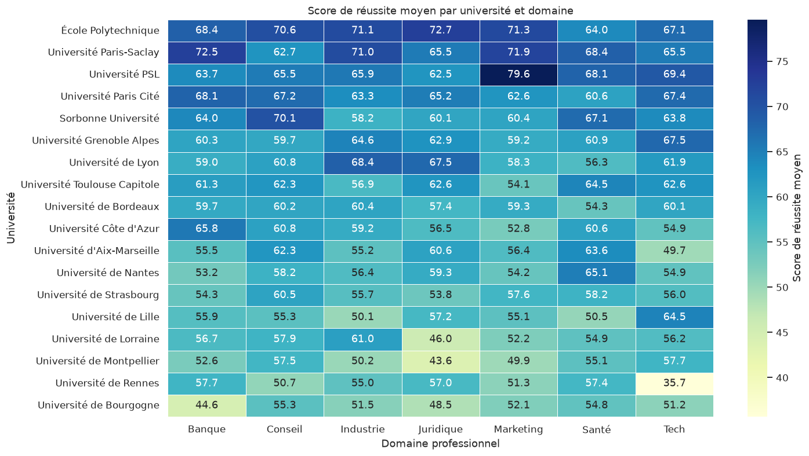

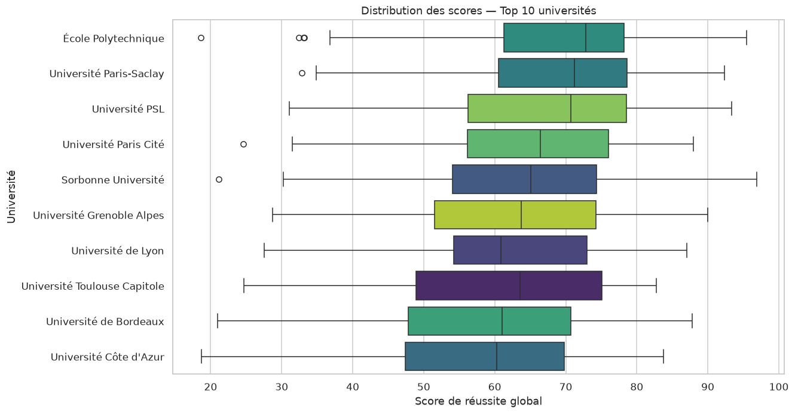

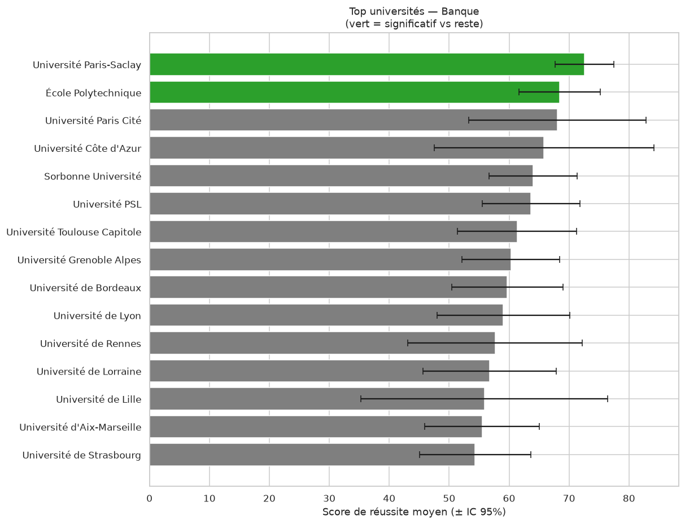

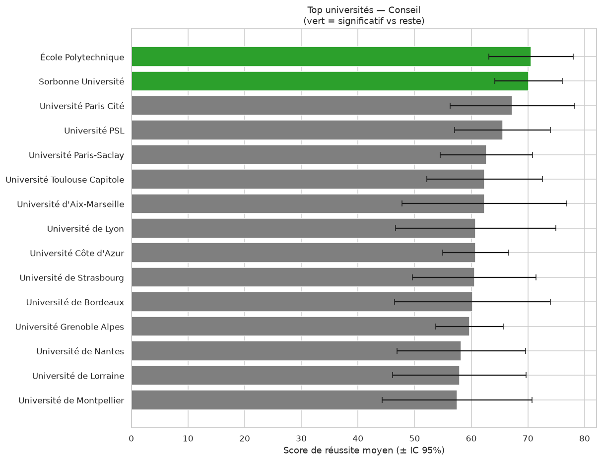

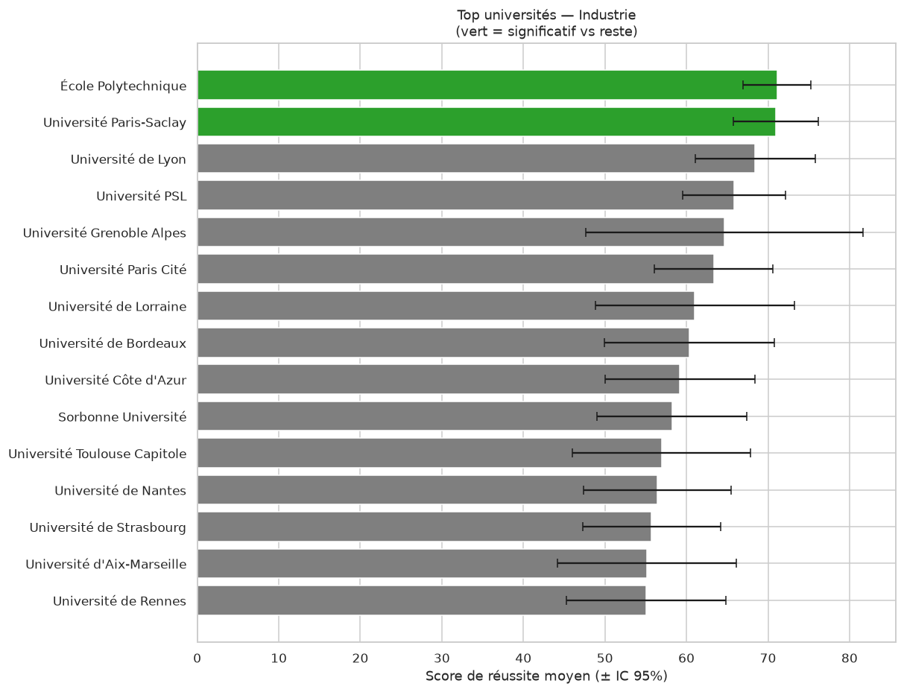

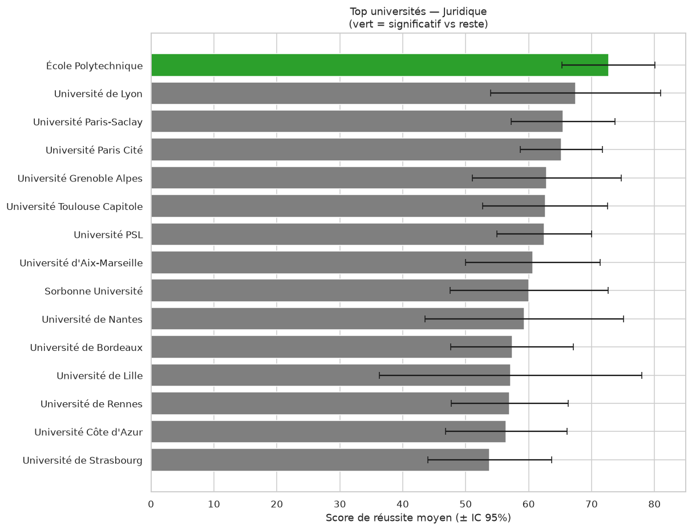

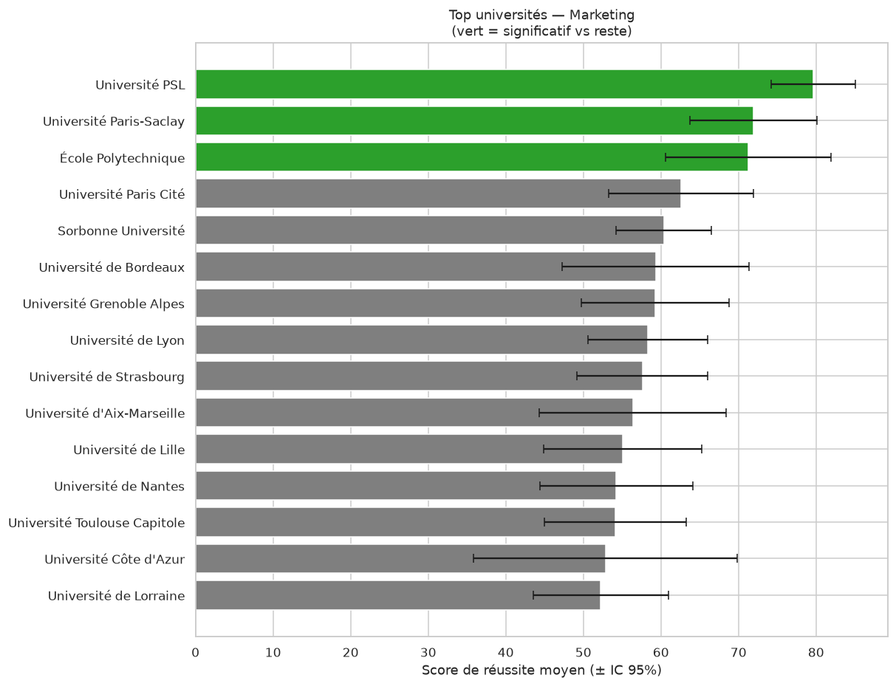

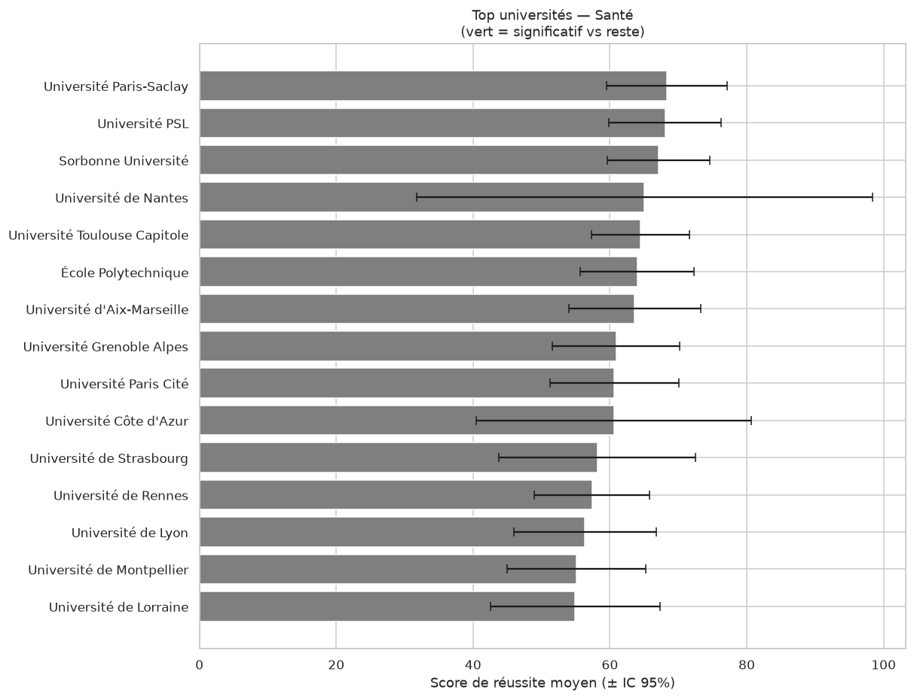

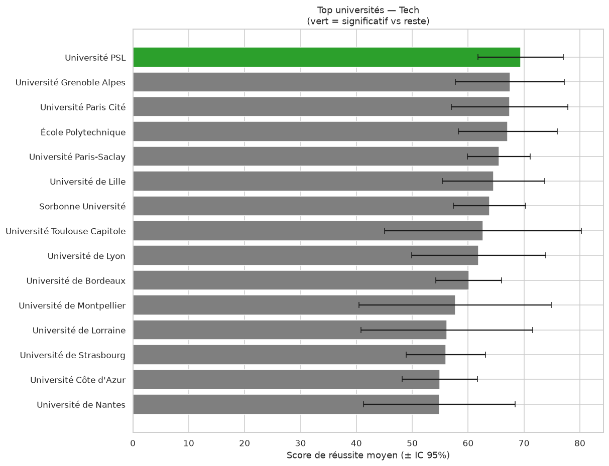

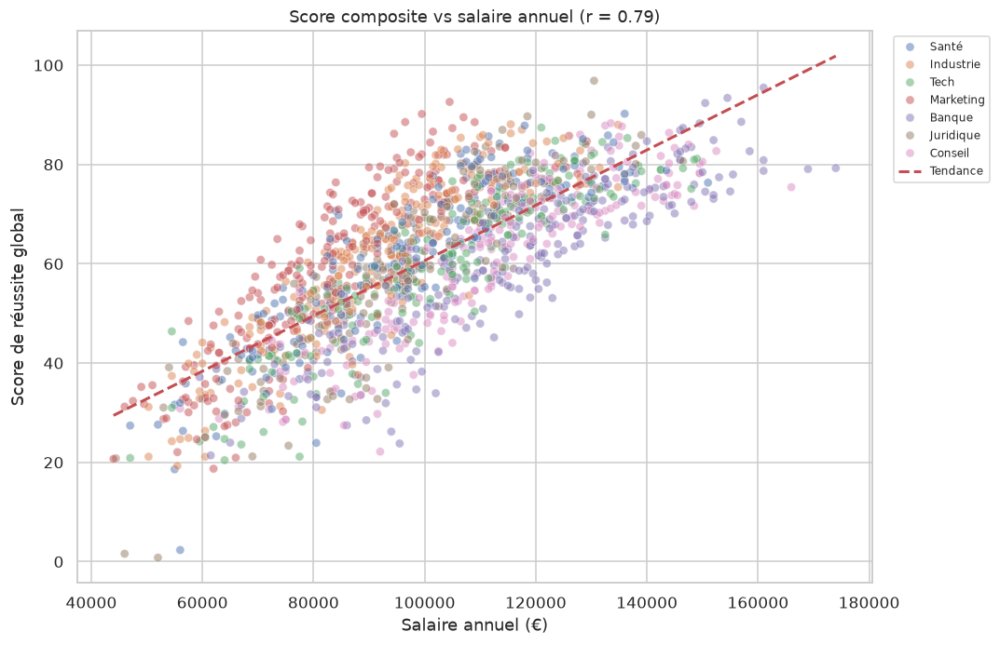

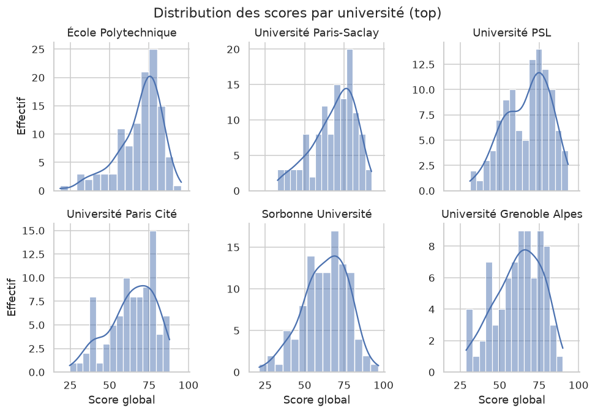

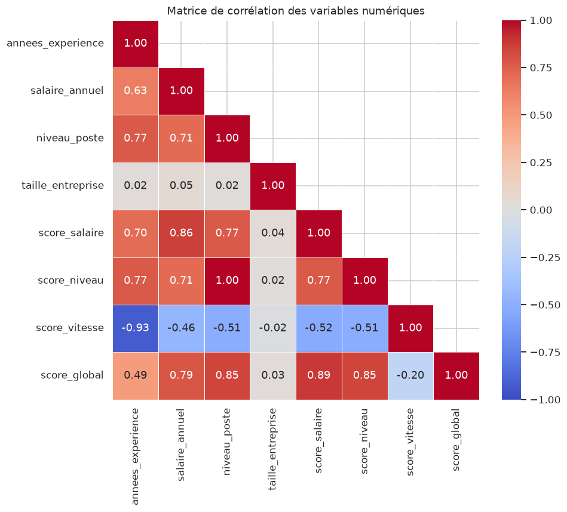
